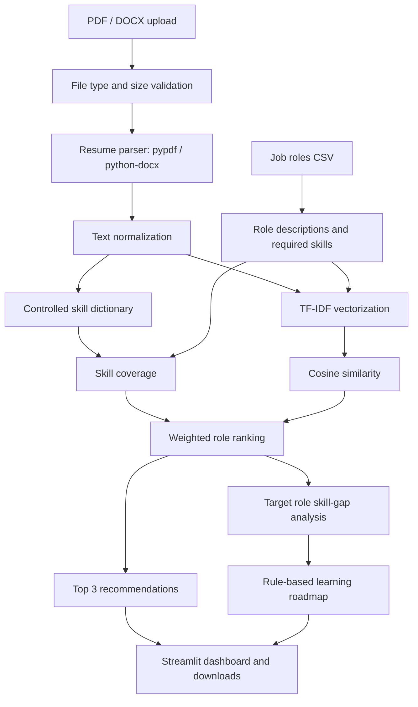

# Architecture and workflow

## Boundaries
- `resume_parser.py`: untrusted file input and extraction.
- `text_cleaner.py`: normalization only; preserves technical punctuation.
- `skill_extractor.py`: controlled-vocabulary detection.
- `job_matcher.py`: TF-IDF/cosine similarity and transparent score.
- `roadmap_generator.py`: deterministic learning suggestions.
- `app.py`: UI orchestration and report downloads.

## Score
`final_score = 0.70 * cosine_similarity_percent + 0.30 * required_skill_coverage_percent`

This is a heuristic for educational exploration, not a probability of being hired.
