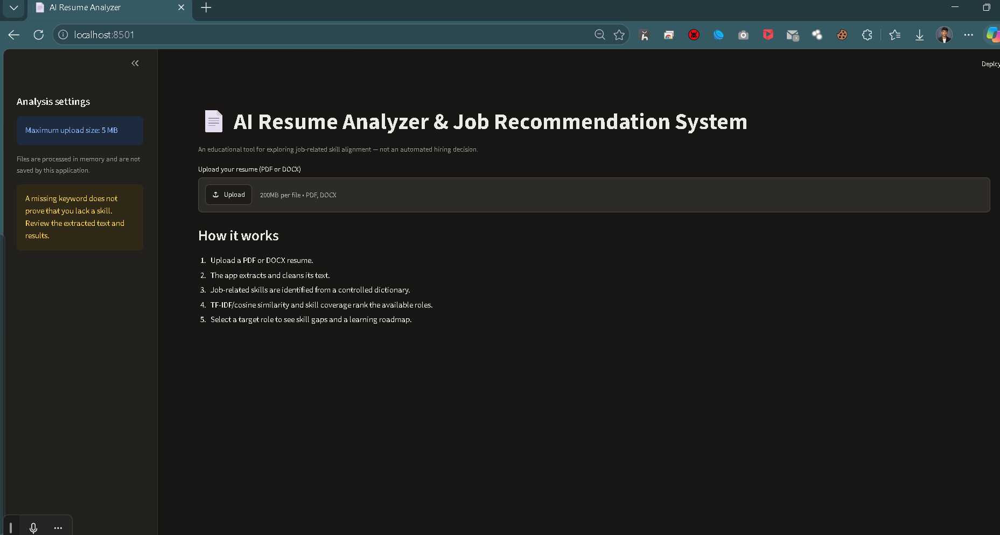
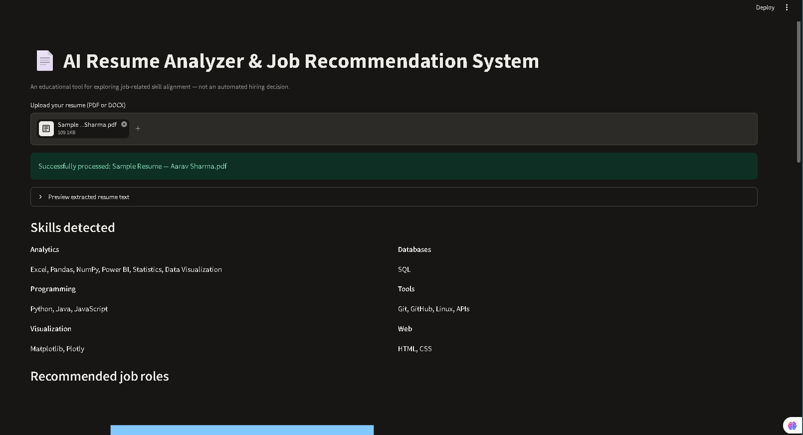
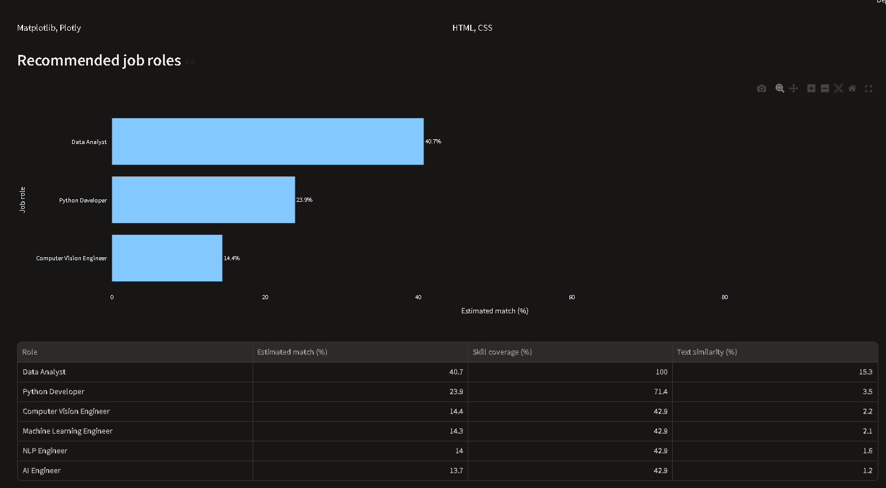
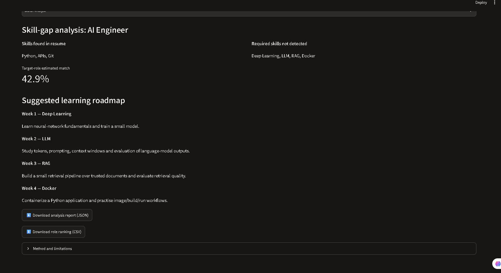
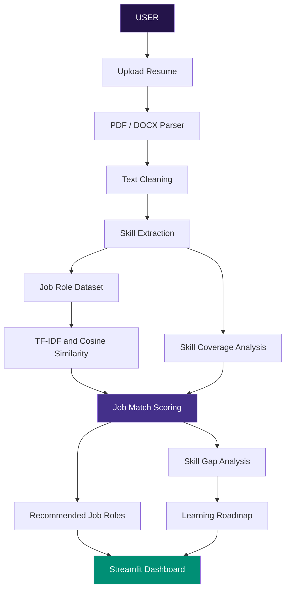

 <div align="center">


# AI RESUME ANALYZER

### AI-POWERED RESUME ANALYSIS & JOB RECOMMENDATION SYSTEM

**Upload. Analyze. Discover. Improve.**

An intelligent resume analysis application built with Python, NLP techniques, skill extraction and job-role matching.

<br>


<br><br>

**DEVELOPED BY HM BHOLA**

<a href="https://github.com/hmbholamajhi-eng">

</a>

</div>

---

# Ⅰ. PROJECT VISION

> What if your resume could tell you which career opportunities match your skills?

**AI Resume Analyzer** is a Python-based application designed to help students and job seekers understand how their resumes align with different job roles.

The application extracts text from uploaded PDF and DOCX resumes, identifies technical skills, compares them with predefined job-role requirements, and generates estimated match scores.

It also highlights missing skills and provides a learning roadmap to help users identify areas for improvement.

The project demonstrates how Natural Language Processing (NLP), text processing, similarity measurement and data visualization can be combined to build a practical career-assistance application.

### Core Workflow

1. Upload a resume in PDF or DOCX format.
2. Extract text from the uploaded document.
3. Clean and normalize the extracted text.
4. Identify technical skills.
5. Compare detected skills with job-role requirements.
6. Calculate estimated job-match scores.
7. Recommend suitable job roles.
8. Identify missing skills.
9. Generate a suggested learning roadmap.

---

# Ⅱ. PROJECT PREVIEW

<div align="center">

### 🚀 AI RESUME ANALYZER — APPLICATION SHOWCASE



**01 — RESUME UPLOAD INTERFACE**

Upload your resume and begin the analysis process.

<br><br>



**02 — EXTRACTED SKILLS OVERVIEW**

View the technical skills detected from the uploaded resume.

<br><br>



**03 — JOB ROLE RECOMMENDATIONS**

Explore job roles ranked using the application's matching logic.

<br><br>



**04 — SKILL GAP ANALYSIS**

Identify missing skills and explore a suggested learning roadmap.

</div>

---

# Ⅲ. PROJECT HIGHLIGHTS

| Component | Implementation |
|---|---|
| Application Type | AI Resume Analyzer |
| Primary Language | Python |
| Interface | Streamlit |
| Resume Formats | PDF and DOCX |
| PDF Extraction | pypdf |
| DOCX Extraction | python-docx |
| Text Processing | Python Regex |
| Skill Detection | Keyword-based NLP |
| Job Matching | TF-IDF and Cosine Similarity |
| Data Processing | Pandas and NumPy |
| Recommendations | Rule-based skill-gap analysis |
| Testing | Python Unit Tests |

---

# Ⅳ. CORE FEATURES

### 01 — RESUME UPLOAD

Upload resumes in supported PDF and DOCX formats.

The application validates uploaded files before processing them.

### 02 — TEXT EXTRACTION

Extract readable text from uploaded documents using PDF and DOCX parsing libraries.

### 03 — TEXT CLEANING

Normalize extracted resume text using text-processing techniques.

The cleaning process preserves technical terms such as:

- C++
- C#
- .NET
- Python
- SQL
- JavaScript

### 04 — TECHNICAL SKILL EXTRACTION

Identify skills using a predefined skill dictionary and keyword matching.

Skills are organized into relevant categories such as programming, data analysis, databases, machine learning and development tools.

### 05 — INTELLIGENT JOB MATCHING

Compare resume content with predefined job-role descriptions using:

- TF-IDF vectorization.
- Cosine similarity.
- Skill coverage analysis.
- Weighted matching logic.

### 06 — JOB ROLE RECOMMENDATIONS

Rank suitable job roles based on estimated resume alignment.

### 07 — SKILL GAP ANALYSIS

Compare detected resume skills with the selected job role's requirements.

Display:

- Skills found in the resume.
- Missing required skills.
- Estimated role match.
- Suggested learning roadmap.

### 08 — LEARNING ROADMAP

Generate a structured learning roadmap based on missing skills.

The roadmap helps users identify what they should study to improve their job-role alignment.

---

# Ⅴ. SYSTEM ARCHITECTURE

<div align="center">

### HOW THE APPLICATION WORKS

</div>



### Processing Pipeline

**UPLOAD → EXTRACTION → CLEANING → SKILL DETECTION → MATCHING → RECOMMENDATION**

| Stage | Responsibility |
|---|---|
| Resume Upload | Accepts PDF and DOCX files |
| Resume Parser | Extracts document text |
| Text Cleaner | Normalizes extracted content |
| Skill Extractor | Identifies technical skills |
| Job Matcher | Calculates role similarity and skill coverage |
| Roadmap Generator | Suggests learning steps |
| Streamlit | Displays results through a dashboard |

---

# Ⅵ. TECHNOLOGY ECOSYSTEM

<div align="center">


<br><br>


</div>

### Technology Breakdown

| Technology | Purpose |
|---|---|
| Python | Core application logic |
| Streamlit | Interactive web dashboard |
| pypdf | PDF text extraction |
| python-docx | DOCX text extraction |
| Regex | Text cleaning and normalization |
| Pandas | Dataset processing |
| NumPy | Numerical operations |
| Scikit-learn | TF-IDF and cosine similarity |
| Git | Version control |
| GitHub | Source-code hosting |

---

# Ⅶ. PROJECT STRUCTURE

```text
ai_resume_analyzer/
│
├── screenshots/
│   ├── 01-home-upload-screen.png
│   ├── 02-extracted-skills-overview.png
│   ├── 03-recommended-job-roles.png
│   └── 04-skill-gap-and-roadmap.png
│
├── sample_resumes/
│   └── sample_resume_for_ai_resume_analyzer.pdf
│
├── tests/
│
├── data/
│   ├── job_roles.csv
│   └── skill_dictionary.csv
│
├── reports/
│
├── app.py
├── resume_parser.py
├── text_cleaner.py
├── skill_extractor.py
├── job_matcher.py
├── roadmap_generator.py
│
├── requirements.txt
├── README.md
├── ARCHITECTURE.md
├── TESTING.md
├── VIVA_QUESTIONS.md
└── .gitignore
```

### Module Responsibilities

| File | Description |
|---|---|
| `app.py` | Main Streamlit application |
| `resume_parser.py` | PDF and DOCX text extraction |
| `text_cleaner.py` | Text cleaning and normalization |
| `skill_extractor.py` | Technical skill detection |
| `job_matcher.py` | Job-role matching and scoring |
| `roadmap_generator.py` | Learning roadmap generation |
| `data/job_roles.csv` | Job-role requirements |
| `data/skill_dictionary.csv` | Skill keywords and categories |
| `tests/` | Automated test files |
| `requirements.txt` | Python dependencies |
| `ARCHITECTURE.md` | Architecture documentation |
| `TESTING.md` | Testing documentation |
| `VIVA_QUESTIONS.md` | Academic viva preparation |

**Security Note:** The `venv/` directory contains the local Python environment. It should not be uploaded to GitHub. Keep private credentials and sensitive files out of version control.

---

# Ⅷ. INSTALLATION & CONFIGURATION

### SYSTEM REQUIREMENTS

- Python 3.10 or newer.
- pip package manager.
- Visual Studio Code or another Python-compatible editor.
- Git (recommended).

### STEP 01 — CLONE THE REPOSITORY

```bash
git clone YOUR_GITHUB_REPOSITORY_URL
```

Replace the placeholder with your actual GitHub repository URL.

### STEP 02 — OPEN THE PROJECT

```bash
cd ai_resume_analyzer
```

### STEP 03 — CREATE A VIRTUAL ENVIRONMENT

**Windows PowerShell**

```powershell
python -m venv venv
```

Activate:

```powershell
.\venv\Scripts\Activate.ps1
```

**macOS / Linux**

```bash
python3 -m venv venv
```

Activate:

```bash
source venv/bin/activate
```

### STEP 04 — INSTALL DEPENDENCIES

```bash
python -m pip install --upgrade pip
```

```bash
pip install -r requirements.txt
```

### STEP 05 — RUN THE APPLICATION

```bash
streamlit run app.py
```

Streamlit will display a local application URL in the terminal. Open that URL in your browser.

---

# Ⅸ. JOB MATCHING METHODOLOGY

The application combines text similarity with skill coverage to estimate how closely a resume aligns with a job role.

### TF-IDF VECTORIZATION

TF-IDF converts text into numerical feature vectors based on term importance.

### COSINE SIMILARITY

Cosine similarity measures the similarity between resume and job-description vectors.

\[
\text{Cosine Similarity}(A,B)=
\frac{A\cdot B}{\|A\|\|B\|}
\]

### SKILL COVERAGE

Skill coverage measures how many required skills are found in the resume.

\[
\text{Skill Coverage}=
\frac{\text{Matched Required Skills}}
{\text{Total Required Skills}}\times100
\]

### WEIGHTED MATCH SCORE

The project implementation uses:

\[
\text{Match Score}=
0.70(\text{Cosine Similarity}\times100)
+
0.30(\text{Skill Coverage})
\]

The final result is an estimated matching score, not a probability of getting hired.

---

# Ⅹ. EXAMPLE ANALYSIS

A sample resume containing Python, SQL, Pandas, NumPy and Power BI may align well with a Data Analyst role.

A Machine Learning Engineer role may require additional skills such as:

- Machine Learning
- Scikit-learn
- FastAPI
- Docker
- MLflow
- Model Deployment

The system can highlight missing skills and suggest learning steps.

**Note:** Actual results depend on resume content and the job-role dataset configured in the application.

---

# Ⅺ. SAMPLE RESUME — TESTING & DEMONSTRATION

To make application testing easier, this project provides a synthetic sample resume for testing PDF extraction, skill detection, job matching and skill-gap analysis.

<div align="center">

### 📄 SAMPLE RESUME

**AI RESUME ANALYZER — TEST DOCUMENT**

</div>

**Sample file name:**

```text
sample_resume_for_ai_resume_analyzer.pdf
```

**Location:**

```text
sample_resumes/sample_resume_for_ai_resume_analyzer.pdf
```

### WHAT DOES THE SAMPLE PDF CONTAIN?

The fictional resume is designed to include:

- Candidate profile and educational background.
- B.Tech in Chemical Engineering.
- Python, SQL, Excel and Pandas.
- NumPy, Power BI and Statistics.
- Matplotlib, Plotly and Data Visualization.
- Git, GitHub and Linux.
- Academic data analysis projects.
- Skills relevant to Data Analyst roles.

It also provides an opportunity to test missing-skill detection for other roles, such as Machine Learning Engineer.

### HOW TO TEST THE APPLICATION

**STEP 01 — START THE APPLICATION**

```bash
streamlit run app.py
```

**STEP 02 — OPEN THE RESUME UPLOAD PAGE**

Navigate to the resume upload section of the Streamlit dashboard.

**STEP 03 — UPLOAD THE SAMPLE PDF**

Select:

```text
sample_resumes/sample_resume_for_ai_resume_analyzer.pdf
```

**STEP 04 — VERIFY TEXT EXTRACTION**

Check whether the application extracts readable resume content correctly.

**STEP 05 — VERIFY SKILL DETECTION**

Check whether the expected technical skills are detected.

**STEP 06 — VERIFY JOB RECOMMENDATIONS**

Review the recommended job roles and estimated match scores.

**STEP 07 — VERIFY SKILL GAP ANALYSIS**

Select a target role and inspect:

- Skills found in the resume.
- Missing required skills.
- Estimated match percentage.
- Suggested learning roadmap.

### SAMPLE PDF TESTING CHECKLIST

| Test Case | Expected Behaviour |
|---|---|
| PDF Upload | Accepts the sample PDF |
| Text Extraction | Extracts readable resume content |
| Skill Detection | Identifies skills present in the resume |
| Job Matching | Calculates estimated role-match scores |
| Role Recommendation | Displays suitable job roles |
| Skill Gap Analysis | Identifies missing role-related skills |
| Learning Roadmap | Generates suggested learning steps |

**Important:** The sample resume contains fictional information and is intended only for software testing and demonstration. It does not represent a real candidate.

---

# Ⅻ. TESTING

Testing is important to verify that the application processes resumes and generates consistent results.

### TESTING AREAS

| Test Area | What to Verify |
|---|---|
| PDF Extraction | Text extracted from PDF resumes |
| DOCX Extraction | Text extracted from DOCX resumes |
| File Validation | Unsupported and oversized files rejected |
| Text Cleaning | Unnecessary spaces and symbols normalized |
| Skill Extraction | Expected skills detected correctly |
| Job Matching | Scores and role ranking calculated |
| Skill Gap | Missing skills identified correctly |
| Roadmap | Learning steps generated |
| Error Handling | Invalid or empty uploads handled |

### RUN TESTS

```bash
python -m pytest tests/ -v
```

If pytest is not installed:

```bash
pip install pytest
```

**Important:** Run the tests locally before claiming that the project passes all test cases.

---

# XIII. RESPONSIBLE AI & LIMITATIONS

AI Resume Analyzer is intended for career guidance and learning support.

Its match scores should not be treated as definitive hiring decisions.

### IMPORTANT LIMITATIONS

- Keyword-based extraction may miss skills written in unusual formats.
- A missing keyword does not necessarily mean a candidate lacks that ability.
- TF-IDF measures textual similarity, not complete professional competence.
- Job-role recommendations depend on the quality of the configured dataset.
- Match scores are estimates and may not reflect actual recruiter decisions.

### RESPONSIBLE DESIGN

1. Focus on job-related skills and qualifications.
2. Do not score candidates based on gender, religion, age, nationality or other sensitive personal characteristics.
3. Handle uploaded resumes carefully.
4. Avoid unnecessary storage of personal information.
5. Clearly communicate that recommendations are guidance, not hiring decisions.

---

# XIV. FUTURE DEVELOPMENT ROADMAP

| Version | Proposed Enhancement |
|---|---|
| V2 | Custom job-description matching |
| V3 | Semantic matching with Sentence Transformers |
| V4 | Resume improvement suggestions |
| V5 | Downloadable analysis reports |
| V6 | Advanced resume section detection |
| V7 | Database-backed user accounts |
| V8 | FastAPI backend |
| V9 | Docker-based deployment |

These are possible future enhancements and should not be interpreted as already implemented.

---

# XV. DEVELOPER PHILOSOPHY

> A resume should not simply list skills. It should help people understand where their skills can take them.

AI Resume Analyzer explores the practical use of Python, Natural Language Processing, text similarity, data processing and interactive dashboards.

The project focuses on helping students identify relevant opportunities and understand the skills they may need to develop.

---

# XVI. AUTHOR & DEVELOPER

<div align="center">


### HM BHOLA

**B.Tech Student | Python Developer | AI & Technology Enthusiast**

Exploring Python, Artificial Intelligence, Data Science, Full-Stack Development and intelligent software systems.

<br>

<a href="https://github.com/hmbholamajhi-eng">

</a>

</div>

---

<div align="center">

# 🚀 KEEP LEARNING. KEEP BUILDING.

### ANALYZE SKILLS. DISCOVER OPPORTUNITIES. BUILD YOUR FUTURE.

**AI RESUME ANALYZER — INTELLIGENT CAREER GUIDANCE**

Made with ❤️, Python and Streamlit.

<br>


**© HM BHOLA**

*An independent academic project.*

</div>